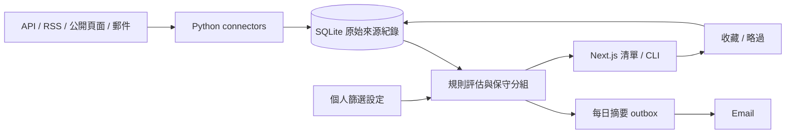

# 多平台兼職探索設計

日期：2026-09-28。產品目的：幫使用者從多平台找到兼職，節省逐站搜尋時間。此頁取代早期提案導向設計；工作進度以 [implementation-plan](implementation-plan.md) 最上方現行工作為準，來源接通仍以 [platform-connectivity](platform-connectivity.md) 為準。

## 範圍

保留技術兼職／固定專案／合約來源：AI agent、AI 整合／自動化、後端／API、全端 MVP。主畫面只需要搜尋、平台／型態篩選、收藏、略過、原文連結與來源狀態。每日摘要幫使用者發現新機會，應徵回原平台完成。

人工投案與跟進已交付為獨立輔助功能：本人填寫投案日期、四階段、跟進日期與備註，可新增手動機會。詳細邊界見[接案工作台契約](#接案工作台契約)。applications 是新人工紀錄的權威，歷史 tracking 不雙寫或自動轉入；收藏不代表投案。新投案關聯參與過期操作檢查，已投案群組退出候選與後續新摘要，既有摘要不改。

第三階段已核准[客戶／聯絡人、純文字模板／草稿版本、站內提醒及Email＋Freelancer官方API送出](#接案工作台契約)，已完成TDD實作與部署；外部通道維持未配置。這些功能獨立於探索：本人建立草稿、核准精確內容及確認送出，才執行外部動作；不引入AI背景工作、LLM、自動挑案或自動應徵。新職缺不自動建立草稿，摘要不攜帶提案內容，不因草稿或客戶更名重新通知。新submission核准與摘要／legacy approval完全分開，queue入列不代表送出；unknown的後續核對追加證據且不解除禁止重送。

## 架構取捨

### 現行部署：Docker Compose＋Huey＋SQLite

2026-09-28 使用者確認此組合，取代專案的 systemd 排程。**重構與部署已完成；正式 VM 執行 Compose frontend／API／Huey worker，舊 digest／AI units 已封存移除。** 現行版本與驗收見 [implementation-plan](implementation-plan.md) 最上方；下方模組責任表已同步至新目錄。

| 選項 | 取捨與決定 |
|---|---|
| venv＋systemd timer | 元件少，但主機環境與排程設定分散；使用者決定替換 |
| Docker Compose＋Huey＋SQLite | 可重建執行環境、Python 管背景工作與排程、不新增 DB server；已選定，須驗證中斷／漏跑處理 |
| Procrastinate＋PostgreSQL | 提供 PostgreSQL 工作佇列、重試與鎖；需增加 DB 維運或資料遷移，本輪不採用 |
| APScheduler | 適合時間觸發；本輪選 Huey 整合工作佇列與排程 |

參考 whisky 的功能模組化、`backend/src/`、bootstrap 組裝、模組公開介面、import 邊界檢查與 wheel 安裝驗證。保留 Next.js、FastAPI／Pydantic、生成契約及 SQLite；不加入對話研究、Temporal、Agent framework、登入系統或 PostgreSQL 遷移。

```text
frontend/src/             app 薄路由、features、shared
backend/src/freelance/
  bootstrap/             API、Huey worker、CLI 組裝
  modules/
    collection/          平台 adapters、解析、增量收集、receipts／版本
    discovery/           篩選、分組、排序、差異投影
    preferences/         設定、收藏、略過
    notifications/       摘要、outbox、寄送 adapters
    applications/        本人填寫的投案、跟進、稽核與來源關聯
    relationships/       獨立客戶／聯絡人及歷史關聯快照
    proposals/           人工模板與不可覆寫的正文版本
    submissions/         精確核准、單次attempt、provider及核對證據
  platform/              SQLite 交易、設定等共用技術能力
  legacy/                舊提案、AI、PostgreSQL 相容程式
backend/tests/           按功能組織，fixtures 不由 test 模組互相引用
contracts/               generated OpenAPI 與 Web types
scripts/                 生成、邊界與安裝驗證
deploy/                  Compose、image build 與回復設定
docs/                    現行規格與歷史資料分開
```

模組透過 `public.py` 的 command／query 合作，不穿透其他模組內部 store／資料表；跨模組原子操作由明確用例協調同一交易。domain 不 import framework；platform 不放業務規則。簡單模組按需拆檔，不預建空層。歷史 row envelope 及核准失效由相容 adapter 承接，新探索用例不處處操作 proposal／review_status。schema、來源 ID、receipt／fingerprint、30 小時預設、通知內容並存與過期操作語意保持；若需要 schema 變更，先提出遷移設計。

Compose 執行三個服務：`web`、`api`、`worker`。API／worker 共用同版本 backend image，worker 執行 Huey consumer（含 scheduler），初版單一 consumer、單一執行 worker，排程不嵌入 API。Web 已部署於同一 VM，僅透過 loopback 與 SSH tunnel 存取。正式 image 固定版本，uv／pnpm 各自鎖定依賴；Python wheel 須能在 repo 外安裝執行，不靠 PYTHONPATH。

產品 SQLite 與 Huey queue SQLite 使用分開的持久化檔案／掛載（邏輯名稱 `app.sqlite`、`queue.sqlite`；正式舊檔不必改名），掛載目錄須涵蓋 journal／WAL sidecars。以非 root 身分與一致 UID／GID 保持 owner-only 資料權限；credentials 在執行時受控掛載，不進 image。API host／Origin／proxy 保護須重新驗證容器網路；不新增公開 endpoint。

Huey 負責工作派送，產品 DB 的 daily run／outbox 仍是執行與寄送權威。兩個 SQLite 檔案沒有跨庫原子交易，不宣稱入列等於完成或 exactly-once；任務以日期／run ID 等穩定識別重查產品狀態。初版定時工作呼叫既有每日用例，避免同時重寫平台流程。平台安全重試與寄送分開，unknown／attempted 不自動重寄，不把整條 daily 任務設成無條件重試。

每日目標仍為 Asia/Taipei 09:00，09:00 後每分鐘檢查當天；重啟可補當天，跨日不補寄，排隊的過期日期不執行。已有任何 daily run 就不重新呼叫來源／寄送；running 與 attempted／unknown 保留人工核對。真 consumer 子程序已驗待辦持久化及中斷後不重送；container／任務版本相容性已由隔離 Compose 驗收，後續發布沿用相關驗證。若 Huey 不滿足所需恢復語意，回報缺口，不自行增加通用工作引擎。切換時確認舊 timer 與新 scheduler 不會同時執行；驗收後退役專案專用 systemd units，Docker daemon 的主機管理不在此替換範圍。

依據：[Huey 文件](https://huey.readthedocs.io/en/latest/)、[consumer 與排程](https://huey.readthedocs.io/en/latest/api.html#consumer)、[Compose production](https://docs.docker.com/compose/how-tos/production/)。

| 方案 | 取捨 | 目前決定 |
|---|---|---|
| 排程腳本 + SQLite + Email | 維護最少；反覆查找及收藏仍需要入口 | 作為資料與通知核心 |
| 上述核心 + 現有 Next.js 清單 | 多一個本機 API，但可互動搜尋與調整條件 | 沿用既有前端，不換框架 |
| 多 agent／佇列／自動投遞平台 | 可管理長流程，但增加狀態、外部依賴與維運 | 本需求不引入 |



worker、API、CLI 使用同一份 SQLite 與探索用例。只支援單機本機儲存，API bind loopback、固定同源 proxy；沒有多租戶或公開 API 需求。Demo 使用獨立 memory SQLite 與同一套用例，只讀程式隨附 schema，不讀憑證或 runtime 設定／外部服務。

### 模組化單體與 API 契約責任

Will 已選參考 whisky 的模組化與 FastAPI 契約；不加入對話研究、Temporal、Agent framework 或公開登入服務。

| 位置 | 責任與資料權威 |
|---|---|
| `backend/src/freelance/modules/collection/store.py` | 來源匯入、receipts、通知內容版本、游標及來源狀態；既有 connectors 呼叫公開收集介面 |
| `backend/src/freelance/modules/discovery/service.py` | 讀取投影、同職缺分組、原子群組收藏；交易內透過公開資料介面組合 |
| `backend/src/freelance/modules/preferences/store.py` | 設定 revision、個人回饋與歷史 tracking ledger；不在 API 恢復歷史應徵管理 |
| `backend/src/freelance/modules/applications/store.py` | 新人工投案與跟進、來源關聯及追加事件；不寄送、不代投、不改歷史 ledger |
| `backend/src/freelance/modules/notifications/store.py` | 固定摘要 snapshot、每日 run、attempt／sent／unknown；外部 sender 仍在 transaction 外 |
| `backend/src/freelance/legacy/review_service.py` | 歷史提案審核與統計，相容入口不公開於 HTTP |
| `backend/src/freelance/legacy/records.py`、`backend/src/freelance/platform/sqlite.py` | 前者封裝舊 opportunity／proposal 列格式與核准失效，後者只管理 SQLite 連線、交易與顯式遷移 |
| `backend/src/freelance/bootstrap/store.py` | 明確組裝模組並保留既有 store／CLI 介面；無 mixin 或動態方法派送 |
| `backend/src/freelance/bootstrap/` | FastAPI、Pydantic request／response 與 OpenAPI；錯誤遮罩、本機 Host／Origin、請求上限與 no-store |
| `frontend/src/features/`、`frontend/src/shared/api/` | 功能畫面與由 OpenAPI 生成的型別，薄路由只組合；候選資格以後端 `candidate` 為準 |

SQLite schema、來源 ID、fingerprint 與交易邊界保留；這次不用資料庫遷移換取程式結構。舊 row envelope 與 `review_status`／tracking 的公開相容欄位保留，避免讓既有歷史略過／投遞失效。探索邏輯不呼叫歷史 review，框架型別不進 domain。增量同步與 outbox 的副作用界線維持原契約。

Python 新增框架依賴有鎖檔；OpenAPI 與 Web types 可離線重生及檢查差異。TypeScript 7 不提供生成器需要的穩定 compiler API，`frontend/tools/contracts` 是限定生成用途的 TypeScript 5 工具套件；當 openapi-typescript 支援應用 compiler API 且生成結果／編譯驗證通過才合併工具依賴。這不改動應用編譯版本。

## 收案與條件

- 來源仍以 `(source, external_id)` 識別，保留 receipt、原始 URL 與證據；未知欄位使用 null。
- 收案先排除有明確依據的全職、無薪、地區／時區不符、過期及非技術專長職缺。個人的工時與 TWD 預算門檻延後到讀取時評估，調整設定不會因先前收案丟失資料。
- 預設每週上限 **30 小時**（使用者確認），可設 1–168 或不限；固定案 TWD 最低預算預設 3,000；分類可勾選。此工時是單個職缺的上限，不是會隨接案自動扣減的排程器。
- 工時／報酬／地區未知仍保留待確認；remote 不代表全球。時薪、合約与外幣不直接套 TWD 固定案底價。
- 設定以 revision 防止過期覆寫，清單與新建立的摘要即時重算；不改已存在的 outbox snapshot。清單查詢只建立投影，不回寫舊 proposal、approval 或版本；讀取使用唯讀連線。

## 去重與人工狀態

分組是可重算的顯示結果，不搬移或刪除來源列。僅用相同 HTTPS 原文連結（保留 query，移除 fragment），或相同公司、職稱、完整內容、合作型態與地點，作為同職缺證據；不同已知工時、報酬、資格等互相矛盾時保持分開。相似職稱、只有通知卡片或公司名稱不足以內容合併。

每組保留所有來源連結。收藏與略過一次作用於當下所有 members，同一交易完成。請求必須攜帶每個 member 的來源 fingerprint 與 tracking revision token；來源內容、分組成員或人工狀態變了就拒絕過期操作。既有任一略過／已投遞紀錄仍會壓住候選，不讓新副本重新出現於通知。

分組後只有少量卡片資料送到介面；舊 proposal、人工 note、evidence 不進 discovery DTO。既有 applied 等狀態保留其歷史意義，主介面不再修改應徵階段。

## 郵件同步

Resend Receiving 依 source／recipient 保存完成游標及進行中的 after／head。沿 newest-first 的頁面順序處理，有 body、page、time 上限；尚未追到上次游標或末頁便標不完整，下一次續讀。

逐封成功或隔離紀錄與已存 receipts 共同避免重讀／重複匯入。單封解析失敗不撤銷其他有效信；暫時 fetch 失敗保留待讀位置。格式未知會維持來源失敗狀態，修正 parser 後透過本機 mail_recovery 指定 rejected ID 重排：保留掃描游標與失敗紀錄，下一次同步只重讀指定 body，重新檢查來源與收件者，並計入原有讀取上限。修復操作不直接讀信。

Will 已選擇「兩份保留並標示差異」。相同來源 ID 的新內容先與既存 fingerprint 比對；不同時在 `mail_content_versions` 保存原紀錄與每份不同的正規化職缺內容，原 `opportunities` 列、proposal／tracking 與歷史送信紀錄不覆寫。來源 receipt 與其他有效職缺在同一交易保存；同內容重播不新增版本。這封信是 processed，清單／摘要顯示各份內容與差異欄位。任一版本可能符合個人條件時，該組留在待看清單；排序及主卡採可能符合版本中分數最高的一份，明示其來源與 fingerprint（畫面及摘要使用前 12 碼版本識別），要求回原平台確認。這只是展示依據，不代表判定來源新舊。收藏／略過仍作用於一個原始職缺組，新版本使舊畫面的操作 token 過期。既有摘要不改，新版本可在後續摘要重新出現。

轉寄接收時間不是來源內容的版本證據；所有版本不標成「最新版」，也不由系統自動採用為原始列。對外清單／摘要的職缺只保留展示欄位，receipt ID、evidence refs 與其他內部欄位不外露；原始正規化版本仍留在 SQLite。真正的 receipt identity 碰撞仍使該封信整批回滾並隔離，與內容差異分開處理。

有 partial／quarantine 不等於完整成功；waiting 表示尚未收到有效的指定通知。公開頁面與 API 的既有界限仍依各 connector，這次未宣稱全平台／全站覆蓋。

## 通知一致性

- 同日／同收件者唯一 intent；snapshot 不變。
- sent／attempted／unknown 的歷史快照抑制已見内容；相同職缺新增來源不重複通知，已知來源內容變更可於後續摘要重新出現。
- 每封顯示報酬、工時、地區與資格依據、內容摘要、匹配分類及原文連結，不附提案。
- 先提交 attempt 再呼叫 sender；程序中斷或無可靠送達證據維持 unknown，不自動重寄。

## 保留相容資料的邊界

SQLite 既有 proposals／tracking events／AI attempts／outbox 表不刪。內部歷史 review、delivery guard、AI adapter、PostgreSQL adapter 與其測試保留，用於舊紀錄與回復；目前 server 與 CLI 不提供其產品操作。舊 ai_worker 入口只回報 retired 並退出，不讀 DB／啟動模型。

這是保留舊資料與可回復性的決定，不是新功能的依賴。只有另行確定按需提案或多機部署需求，才重新評估這些元件；不沿用早期未完成清單繼續擴張。

## 驗證與上線界線

新增同步／偏好／分組測試及真暫存 SQLite + 瀏覽器流程；既有 outbox、不確定寄送、核准失效與來源失敗測試繼續保留。Python worker 已於 2026-09-28 切換至 VM；本機及 VM 離線驗證不代表下一次自然排程已驗收。部署證據、資料備份及 AI timer 狀態見現行 implementation-plan。

參考：[Resend pagination](https://resend.com/docs/api-reference/pagination)、[SQLite 適用範圍](https://www.sqlite.org/whentouse.html)。平台抓取格式與權限以各來源文件及實測記錄為準。

## 來源管理收斂

`collection/source_catalog.py` 的靜態 registry 集中 ID、名稱、啟用群組與 runner；公開／郵件來源保留固定執行順序及各自呼叫型態。新 runtime 設定可用 `sources` 明確選來源，不能與舊來源 flags 混用；舊 flags 保留相容。未接通的研究來源沒有 runner，不能藉此啟用。

connector 只透過 `source_batch` 的 existing IDs／jobs、ingest、finish 操作資料；collection store 擁有 SQL。共用批次沿用 caller transaction，Resend 保留逐封交易；平台 filter／新舊更新政策維持。boundary gate 拒絕 connector 直接開連線或執行 SQL。

Dashboard 的 `operations` 分別呈現最新 source_health 檢查及最近每日 run 的有限統計，兩者不假定同一輪。寄送結論從該日 outbox 讀取；來源 partial 與 sent 可並存。設定 flags 只代表操作者已宣告設定啟用，沒有 worker heartbeat 的即時宣稱。缺紀錄／欄位保留 unknown，provider 原始錯誤、私人路徑、收件者與receipt不進此投影。

## JSON codec 責任

platform的row factory只回傳欄位mapping與SQLite scalar，通用JSON encode不認識產品欄位。舊opportunity item由legacy records明確解碼；按來源讀取也透過該相容adapter。notifications store在每個digest／daily query與claim結果明確解碼snapshot／result，再提供公開dict。null保留None；壞JSON仍拋錯，不隱藏損壞。既有JSON text格式與transactions不变，不改schema或重寫資料。

## 接案工作台契約

目前第三階段已部署，Email／Freelancer通道未配置。探索不自動挑案、建立草稿或應徵；客戶、草稿與送出保持獨立模組。

### 三階段範圍

1. 私人投案表及人工習慣：歷史備援。
2. 工具內的人工投案日期、四階段、跟進與週統計：已交付。
3. 客戶／聯絡人、模板／草稿版本、站內提醒及精確核准送出：程式已部署；真實通道驗收由使用者延期。

操作流程見[功能說明](features.md)；原路線與TDD證據見歷史紀錄（私人封存 repo 的 `docs/implementation-history.md`）。

### 最小產品規格

#### 客戶／聯絡人

- 客戶：UUID、名稱、備註、revision、建立／更新時間、封存時間。
- 聯絡人：UUID、所屬客戶、名稱、可选聯絡方式、備註、revision與封存時間；聯絡方式只存文字，不觸發郵件／撥號。
- 客戶名稱或聯絡方式相同不自動合併。使用者可修改或封存；不硬刪舊關聯。
- 投案關聯最多一名主要客戶及一名該客戶下的聯絡人，均可空；不從既有contact字串自動建客戶。
- 明確關聯時保存名稱／聯絡資訊snapshot，客戶更名或封存不改既有投案脈絡；重新指定須由本人操作。
- 客戶詳情以分頁查詢關聯投案，不下載全部職缺。手動轉介仍不依賴discovery。

#### 模板與提案草稿

- 使用本人撰寫模板與可編輯草稿，不引入LLM provider、AI排程或自動生成個人經歷。
- 模板欄位：名稱、純文字內容、revision、封存狀態。占位符僅允許明確白名單，例如機會名稱、客戶稱呼、本人填寫的合作方式、作品與報價；未知占位符拒絕、缺值明示待填。
- 純文字代入，不執行Python／JavaScript／HTML或任意模板表達式。來源內容只能當資料。
- 草稿可在投案前獨立存在；UUID与人工投案ID分開，無來源的手動草稿不建立假職缺。
- 從來源準備草稿需核對完整members與tokens，保存來源ID／內容版本及必要欄位snapshot。新通知或模板修改不重寫舊草稿；重新套模板建立新版本。
- 草稿每次儲存新增immutable revision，舊版本可讀；過期編輯409保留本人草稿、核對最新版本後才再次提交。
- 複製的是畫面明確選中的版本；不記為sent／applied，不建立通知outbox或寄送approval。本人審閱與外部投案仍在人工流程。
- 本人確認的作品與報價由本人填入，不讀舊portfolio設定、不推定資格或可承接工時。

#### 站內提醒

- 沿用applications的follow_up_on、stage及Asia/Taipei日曆日。
- 主導覽顯示今日與逾期數量，投案頁提供due篩選及按跟進日期排序的清單。
- 只對未刪除且applied／negotiating的紀錄顯示；won／closed退出提醒。
- 日期或階段更正後，下次查詢立即反映。提醒查詢不寫入DB，不新增Huey任務、提醒ledger或第二個排程。
- 不新增「已讀」權威：真正處理方式是更新跟進日期或階段，避免已讀但仍逾期的矛盾。

### 資料模型與一致性

內部七張表加上送出兩張表，共九張；不ALTER既有投案欄位以保持舊版可讀：

- clients、client_contacts：客戶與聯絡人；revision、封存、建立請求的payload及idempotency識別。
- application_parties：投案ID唯一；可空客戶／聯絡人及名稱snapshot。由applications持有，客戶合法性由relationships公開介面驗證。
- proposal_templates：本人模板，revision與封存。
- proposal_drafts：草稿metadata／目前revision／來源及客戶識別／建立請求識別。
- proposal_draft_revisions：草稿ID＋version唯一，純文字結果與渲染輸入／template版本／來源snapshot；追加式。
- application_proposals：applications持有的一筆投案對一個草稿版本；可選submission identity與證據snapshot。獨立於可空客戶關聯，避免沒有客戶的投案必須造假客戶。submission ID唯一，原子建立投案與關聯，投案事件故障不得撤銷provider接受證據。

客戶／聯絡人與草稿編輯需要revision compare；建立請求精確payload重播，不同payload409。封存行不供新關聯，但舊紀錄仍可查看；不級聯刪歷史。

bootstrap在同一transaction核對application revision、客戶與聯絡人的revision／所屬／有效狀態，再呼叫applications公開關聯用例。關聯更正要增加application revision、追加現有稽核事件，讓舊投案畫面失效；不能另有一個不參與過期操作檢查的連結版本。

建立來源草稿同交易核對discovery公開tokens，再寫草稿與首版本；一個版本寫入失敗不得留下半份metadata。客戶關聯或草稿不改候選／收藏／略過；只有既有人工投案規則排除候選。

既有application contact文字、tracking、receipt、daily、digest snapshot均保留，不自動遷移到新實體。個資／提案內容不進每日摘要、來源DTO、log或metrics。

### 外部寄送／平台投案（已選入範圍）

#### 首版通道對帳

| 通道 | 權威證據 | 第一版建議與關卡 |
|---|---|---|
| Email | 現有Gmail SMTP transport已用於摘要，但deliver綁定摘要及寄给本人 | 新獨立提案sender／envelope；只重新評估連線能力，不復用digest approval／outbox。每次核准完整from／to／subject／body |
| Freelancer | [官方SDK投標範例](https://github.com/freelancer/freelancer-sdk-python/blob/master/examples/place_project_bid.py)、[官方developer入口及sandbox](https://developer.freelancer.com/) | 建議首個平台adapter；另需帳號及OAuth權限，先驗sandbox，再做正式唯讀資格／連線核對 |
| Upwork及其他平台 | [Upwork自動化規則](https://support.upwork.com/hc/en-us/articles/43342677368467-Use-bots-and-other-automation-properly)要求API核准且限定核准用途 | 逐平台核對實際submit endpoint、帳號權限與費用；沒有已驗通道就明示不支援，不能用搜尋connector冒充submit能力 |

首版通道已選Email＋Freelancer官方API。新平台登入／憑證配置另依本輪具體授權；程式驗收先用合成資料。真實投案／寄送需要具體案件、目的地、完整內容及費用核准，不能把功能開發授權當成代投真案。

#### 內容核准與送出用例

1. 從指定草稿版本建立單一不可變submission intent，包含purpose、provider／環境、帳號識別、目的地、完整正文及所有平台欄位。
2. Email完整顯示寄件人、收件人、主旨與正文；Freelancer完整顯示project ID、本人bidder ID、幣別／amount、period、milestone percentage及description，費用或資格未知不能偽造通過。
3. 本人在畫面核對並核准snapshot hash。修改草稿版本、目的地、帳號、環境、報價或正文後需要新intent與新核准；來源內容已變時重新核對來源，不沿用舊核准。
4. 本人點擊「確認送出」才入列；只使用既有唯一Huey worker執行新on-demand任務，站內提醒仍不增加排程。避免在8秒Web proxy請求中持有20秒SMTP／HTTP連線。
5. product SQLite是送出權威。核准與入列分庫，不宣稱跨庫原子或exactly-once；重複queue task以同intent claim攔下。入列失敗但尚未attempted可由本人重新要求入列；不由daily discovery自動派送。
6. worker在transaction內重查精確核准、帳號／環境、來源／草稿版本及未attempted，持久化attempt後才呼叫provider；外部網路不持有SQLite transaction。
7. 取得可驗供應商接受證據才標accepted，明示不是雇主已讀／錄取。SMTP只表示server接受，Freelancer核對returned bid ID及案件／帳號；缺ID、timeout、程序中断或DB提交失敗保留attempted／unknown。
8. attempted／unknown不自動重送；重啟只保留證據並提供唯讀核對，不能因queue消失、HTTP timeout或使用者reload再呼叫provider。
9. accepted intent可由本人一鍵建立／關聯人工投案。投案寫入失敗時保留供應商證據；重試建立投案不能重送，既有重複職缺規則仍有效。

新submission的狀態：prepared → approved → attempted → accepted／rejected／unknown；未attempted可cancelled。queued只是派送資訊，不是業務成功。明確provider拒絕可rejected，無法確定是否作用時unknown；不以所有exception當作安全失敗。

#### 不確定結果的人工結案

原始transport status不覆寫。後續核對以追加reconciliation event記錄結果、證據種類、provider識別與時間；同一intent的核對操作採revision防過期。Freelancer唯讀查回相符bid，核對本人、project、完整description、amount、period與milestone，可記provider_verified_accepted。第一版沒有可靠事後拒絕查證通道，不提供provider_verified_rejected；沒有查到bid仍為unknown。單純本人陳述記user_reported，不能冒充provider receipt；SMTP查不到接受證據時仍為unknown。本人可引用原intent及核對結果建立人工投案，介面明示證據等級；任何核對結果均不解除attempted的禁止重送。

#### Queue版本與回復

submission task使用固定名稱與payload schema version；不認得的版本在provider呼叫前拒絕並保留產品證據。回復到只懂daily的舊版前，先停API入列、停止唯一worker並確認程序退出；已attempted而未有結果的intent保留不確定。再以產品交易取消所有尚未attempted的approved intents並追加事件，避免恢复新版時舊核准自行執行。

保留完整新queue及sidecars，舊consumer改用另一個owner-only rollback queue檔，不消費新submission task；daily仍由同一product claims防重複。恢复新版時停舊consumer，恢復原queue；原pending task只能讀到cancelled或attempted而不呼叫provider。需要送出的未attempted案件由本人建立新intent、重新核准與入列。驗收涵蓋新task已入列後回復、外部attempt期間停止、舊版daily正常與恢復新版不重送；不能僅用升級schema可讀宣稱回復安全。

#### 儲存與模組邊界

新增submissions模組，另加submission_intents與submission_events兩表；含application_proposals共九表。intent snapshot及核准內容不可變；event追加保存transition／provider receipt／核對資訊，內容不進log。Digest outbox、daily claims與legacy approval均保持原purpose及權威，沒有雙寫或共用新核准。

bootstrap組裝API入列與worker provider；配置明確opt-in，demo永不讀憑證、入真queue或連外。Provider／sandbox host由固定白名單控制，不接受職缺正文提供的callback URL。API DTO不含token、app password或完整runtime設定。兩個既定通道能力分為not_configured／configured_unverified／sandbox_verified／live_ready；後兩者需owner-only runtime內與帳號／環境綁定的操作者驗收證據，不以mock通過推定已配置。其他平台沒有送出adapter，不提供其prepare能力。
