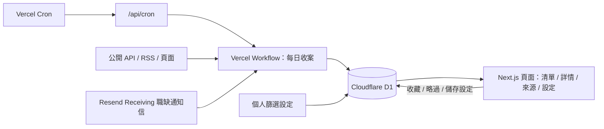

# 多平台兼職探索設計

產品目的：幫使用者從多平台找到兼職，節省逐站搜尋時間。本頁描述現行系統（2026-11-06 起正式運作的 `web/`）。決定的來龍去脈在[遷移計畫](plans/2026-10-23-nextjs-vercel-migration.md)的「決定」一節（下文以 D 編號引用）與 [`docs/adr/`](adr/)；來源逐站狀態在[平台接通主表](platform-connectivity.md)。

## 範圍

**做的事**：每天從已接通的來源收進技術兼職／固定專案／合約職缺，依個人條件評估、排序，讓本人在網頁上看清單、收藏、略過，再回原平台處理。專長分類是 AI agent、AI 整合／自動化、後端／API、全端 MVP。

**不做的事**：

- 不寄信、不建每日摘要（D22）。程式裡沒有摘要與寄信功能，正式環境沒有寄送憑證。
- 不自動提案、不自動應徵、不做 CRM。沒有 LLM 或 AI 背景工作。
- 不跨來源合併職缺（D18）。
- 舊系統的人工投案、客戶／聯絡人、提案模板與草稿、外部送出，目前沒有畫面與寫入路徑（D23）。資料留在歷史表，見「保留的歷史資料」。
- 沒有離線示範模式（計畫「範圍」列為延後）。

## 架構



| 決定 | 選擇 | 理由與代價 |
|---|---|---|
| 執行環境（D1、D3） | 同一個 repo 的 `web/`，Next.js 全端，部署到 Vercel `iad1` | 不再維護主機。Hobby 方案的 cron 不準點、函式有時間上限 |
| 每日工作（D2、D5） | Vercel Cron 觸發 Vercel Workflow；台灣時間 09:00 一支、12:00 補跑一支 | 步驟可持久化、同平台。workflow 會記錄每個步驟的輸入輸出，所以步驟之間只傳 ID、計數與狀態 |
| 資料庫（D19、D21） | Cloudflare D1，經 REST API | 免費、不收傳輸費。沒有互動式交易，有每日列讀寫額度與 API 請求上限 |
| 並行寫入（D20） | 一列寫入租約加 fencing token | 個人使用、來源依序執行，一把全域租約就夠。代價是寫入彼此排隊 |
| 清單讀取（D16、D18） | 寫入時維護的衍生投影表，SQL 排序與分頁 | 每次讀全表會吃掉讀取額度。代價是寫入要多維護兩張表 |
| 存取控管 | Vercel Authentication 加上寫入請求的來源檢查 | 只有本人看得到；不另做登入系統 |

### 程式結構

```text
web/src/
  app/          頁面與 route；只做參數解析、呼叫 services、輸出 HTML
  workflows/    每日收案的 workflow 與 step
  services/     跨模組的用例：daily（每日執行）、discovery（清單與寫入）、pages（頁面用的資料）
  modules/      collection、discovery、preferences、notifications、applications、legacy
  db/           D1 client、schema、寫入單元、migration 套用
  platform/     HTTP、錯誤型別、py/（v1 雜湊相容所需的解析與序列化）
  ops/          儲存觸發條件檢查
```

依賴方向由 `web/.dependency-cruiser.cjs` 強制（`pnpm boundaries`）：

- 模組之間只能引用對方的 `public.ts`。
- `discovery` 是葉節點，不引用其他模組；需要多個模組一起做的事放在 `services/`。
- `modules` 不引用 `app`、`workflows`、`services`；`db` 與 `platform` 不引用任何上層。
- `ops` 只讀資料表，不引用產品模組；產品程式也不引用 `ops`。

| 模組 | 責任 |
|---|---|
| `collection` | 來源目錄、各來源的 connector、信件同步、收案寫入（職缺、receipt、內容版本、來源健康狀態） |
| `discovery` | 資格規則、排序、篩選設定、清單投影 |
| `preferences` | 收藏／略過等個人回饋與其事件紀錄 |
| `notifications` | `daily_runs`：每天一次的執行認領與結果。名稱沿用舊系統，現在不寄任何通知 |
| `applications` | 歷史人工投案的唯讀投影（只用來判斷職缺是否已投案） |
| `legacy` | 歷史職缺列格式（envelope）的讀寫 |

## 資料

資料庫裡有三類表：

- **25 張產品表**：從舊系統原樣搬來的權威資料。結構的唯一權威是 `web/src/db/schema.ts` 加 `web/drizzle/` 的 migration，`pnpm db:check` 在 CI 檢查兩者一致。
- **衍生表** `discovery_items`、`discovery_versions`：清單投影，可由產品表重建。
- **D1 專屬記帳表** `writer_lease`、`write_attempts`、`guard`：寫入租約用，不是產品資料。

### 寫入單元

D1 每個請求自動提交，一個 batch 是一個原子請求，沒有跨請求的交易。所以一次「讀取、判斷、寫入」做成一個寫入單元（`web/src/db/unit.ts`）：

1. 一個請求取得寫入租約，並做完這個單元要依據的所有讀取。
2. 在記憶體裡計算；單元內後面的步驟看得到前面尚未送出的寫入。
3. 一個寫入 batch，開頭是租約守衛。租約被別人拿走時守衛讓整批中止，單元從讀取重來。

正確性靠 D1 在 batch 內原子檢查守衛，不靠時鐘。D1 client 會拒送沒有守衛卻寫租約表的 batch（`web/src/db/d1/guard.ts`），所以不是每條寫入路徑各自記得要加。

不走租約的只有幾張以單一條件式語句寫入的表：`daily_runs`、`source_health`、`mail_ingestion`、`mail_sync_state`。

請求結果不明（回應遺失、逾時）時，寫入不能直接重送：先以 `write_attempts` 查這批是否已提交。

### v1 雜湊邊界

職缺 ID、內容指紋、receipt ID、核准雜湊，以及產生它們輸入的解析（`web/src/platform/py/`），維持從舊系統移植來的 v1 格式。原因是資料庫裡已存的值要繼續對得上：改了就會把舊職缺當成新的重收。

- `web/tests/fixtures/golden.json` 是凍結的對照基準。產生它的工具已刪除，不能再生。
- `(source, external_id)` 唯一；`external_id` 不變。
- 參與雜湊的欄位（例如 `opportunities.item`）以文字原樣保存，序列化集中在 `web/src/platform/py/json.ts`。
- 要換格式只能是一次有版本的變更：新版本雜湊、已知職缺一次重新基準化、v1 函式保留來驗證舊列（計畫步驟 14「窗口結束後換版本」）。

邊界以外的程式是原生 TypeScript，不以舊系統的輸出為規格（D17、[ADR](adr/2026-10-26-digest-ledger-shared-read-model-native-port.md)）。

## 每日收案

- 兩支 cron 都呼叫 `/api/cron`，以 `CRON_SECRET` 驗證後啟動 workflow。
- **每天最多一次**：第一步在 `daily_runs` 以 `(local_date, recipient)` 插入當天一列。已有列就結束，所以補跑的 cron 與重複觸發都不會重跑來源。台灣時間未滿 09:00 不執行；跨日不補。
- 來源依目錄順序**逐一執行**，一個來源一個 step。並行沒有好處：寫入共用一把租約。
- 每個來源開始前先把健康狀態標成 `failed`，成功才改回，中斷不會留下過期的 `ok`。
- 所有 step 不自動重試。中斷的執行停在 `running`，由人核對，不自動重跑。
- 結果：全部來源 `ok` 或 `waiting` 才是 `complete`，否則 `failed`。每個來源的狀態與計數、這次的 D1 用量寫進 `daily_runs.result`。

來源目錄在 `web/src/modules/collection/source-catalog.ts`，connector 對照在 `registry.ts`。每日執行的來源是「目錄裡有 connector、且沒有 `disabled` 原因」的那些。目前沒有不經部署就能切換的開關；等第一次有來源需要比部署更快關掉時才做（計畫步驟 14）。PTT 兩個來源因 Vercel 出口被 403 challenge 而停用（D12），不繞過。

### 收案規則

- 來源以 `(source, external_id)` 識別，保留 receipt、原始網址與依據；未知欄位存 null。
- 收案時只排除有明確依據的項目：來源標示結案、明示無薪或僅股權、不在專長範圍、全職、台灣資格或時區明確不符、已過截止時間。
- 個人的工時上限與 TWD 預算門檻**不在收案時套用**，延後到讀取時評估。調整設定不會因為先前收案時被濾掉而丟資料。
- 同一內容重讀不重複新增。單一項目缺必要欄位時只拒收那一項，來源記為 `partial`。

### 信件來源

讀 Resend Receiving（只送 GET，只允許 `https://api.resend.com/emails/receiving` 底下的網址）。寄件者與主旨先過濾，再交給各站的 parser。

- 依來源與收件者保存游標；每次有信件數、頁數與時間上限，沒追到上次游標就記為不完整，下次續讀。
- 逐封記錄處理結果。單封解析失敗只隔離那一封，不撤銷其他有效信。有隔離或掃描不完整時來源記 `failed`；還沒收到有效的職缺通知記 `waiting`。
- 信件正文只在同步函式內處理，離開它的只有計數與狀態。
- **同一職缺的通知內容不同時，兩份都保留**：新內容和既存指紋不同時，另存一筆內容版本，原職缺列不覆寫。詳情頁列出各份內容與差異欄位。轉寄時間不是來源內容新舊的證據，所以不標「最新版」。新的內容版本會讓舊頁面上的操作 token 過期。

## 條件評估與排序

- 設定三項：每週工時上限（預設 30 小時，可設 1–168 或留空表示不限）、固定專案最低預算（預設 TWD 3,000）、專長分類。這個工時是單個職缺的上限，不是會隨接案扣減的排程器。
- 評估結果三種：`qualified`（條件吻合）、`needs_info`（有待確認項目）、`excluded`（有明確不符的理由）。理由與待確認項目都列給使用者看。
- **未知就是未知**：工時、報酬、地區資格、時區、截止時間不明時列為待確認，不當成符合。remote 不代表全球。時薪、合約與外幣不套固定專案的 TWD 底價。
- 候選：沒有被排除、沒有被略過、沒有投案紀錄的職缺。清單候選在前，再依推薦分排序。
- 設定以 revision 防止過期覆寫。儲存設定時，在同一個寫入單元內重算所有職缺的投影欄位。

## 不跨來源合併（D18）

每筆職缺自成一組。2026-10-26 在資料上量到：既有的合併規則從未合併過任何兩筆，放寬規則又會誤併。所以不做合併，資料形狀維持「一組一個成員」。

加回去重的觸發條件：近 7 天候選裡，跨來源同職稱的配對達 3 組，且人工抽樣確認是同一職缺。每次每日執行都會量這個數字，`/sources` 頁顯示近 7 天的訊號（見[操作手冊](operations.md)）。

## 個人回饋

- 回饋三種：收藏（`interested`）、略過（`skipped`）、還原成未標記（`neutral`）。收藏只表示值得評估，不代表已投案。
- 寫入請求帶著頁面渲染當時的 token。職缺出現新內容版本、回饋已被改過、或投案紀錄有變，token 就不同，請求被拒絕（409），要重新載入。
- 每次回饋都追加一筆事件紀錄，不覆寫歷史。

## 網頁與存取控管

- 頁面全部在伺服器渲染，只輸出白名單欄位（`web/src/services/pages.ts`）；receipt ID、依據參照等內部欄位不離開伺服器。
- 職缺網址是不可信資料：只有不帶帳密的 `https:` 連結才會變成可點的連結。
- 寫入是一般的 HTML 表單。每個寫入請求先過 `web/src/app/_lib/guard.ts`：`WEB_WRITES` 要是 `on`、Origin 要和站台相同、Content-Type 要是 urlencoded 表單、body 最多 16 KiB。
- 寫入成功回 303 帶固定的通知代碼，頁面把代碼對到文字，不顯示網址裡的任意文字。
- 職缺與信件內容永遠只是資料，不是給工具執行的指令。

## 保留的歷史資料

25 張產品表裡，下面這些是舊系統功能留下的，沒有畫面，現行程式也不產生新的業務紀錄：

- 提案與 AI 草稿：`proposal_revisions`、`ai_draft_attempts`。
- 每日摘要：`digest_outbox`。
- 人工投案：`manual_applications`、`manual_application_opportunities`、`manual_application_events`、`application_parties`、`application_proposals`。
- 客戶與聯絡人：`clients`、`client_contacts`。
- 提案模板與草稿：`proposal_templates`、`proposal_drafts`、`proposal_draft_revisions`。
- 外部送出：`submission_intents`、`submission_events`。

規則：

- 不刪表、不改寫列。草稿版本、送出紀錄與其事件、摘要 snapshot 的不可修改／不可刪除，由資料庫 trigger 守住（`web/drizzle/0001_triggers.sql`）。
- 現行程式讀其中兩處：職缺列裡的歷史審核狀態與人工投案關聯，用來把已略過、已送出、已投案的職缺排除在候選之外。
- 歷史核准的失效保護仍在（`web/src/modules/legacy/records.ts`）：職缺被略過，或重新評估後不再符合條件時，舊的核准狀態退回草稿、核准雜湊清空。儲存一筆仍帶有歷史提案文字的職缺時，照舊格式補記對應的 `proposal_revisions` 列；現行程式不會產生新的提案文字。
- 要恢復其中任何功能時重新設計，不從舊文件的待辦清單接著做。新功能不沿用舊的寄送核准。

## 驗證

`pnpm test` 在本機 D1 替身上跑（`web/src/db/d1/local.ts`）。替身會拒絕 D1 會拒絕的東西（交易語句、超過 100 個參數、SQL 超過 100 KB），batch 同樣是原子的，所以在這裡通過的程式不會送出 D1 不收的請求。`pnpm test:d1` 在 CI 的專用測試資料庫上驗證替身和真的 D1 行為一致。

測試涵蓋：增量收案、過期的回饋與設定、來源失敗、未知資格、寫入租約被搶與結果不明時的處理、v1 雜湊對 `golden.json`。指令見 [README](../README.md#驗證)。
