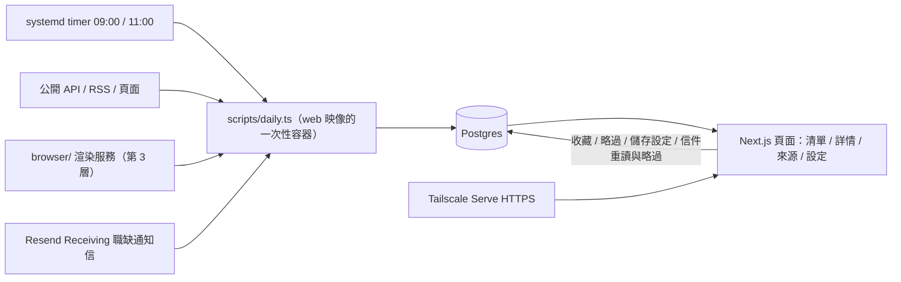

# 多平台兼職探索設計

產品目的：幫使用者從多平台找到兼職，節省逐站搜尋時間。本頁描述現行系統：自建 VM 上的 `web/`（Next.js）加 Postgres，2026-11-17 起是正式系統。決定的理由在[自建重構計畫](plans/2026-11-15-self-hosted-rebuild.md)的「決定」一節（下文以 D 編號引用；D18、D22 沿用舊遷移計畫的編號，自建計畫照舊採用）與 [`docs/adr/`](adr/)；來源逐站狀態在[平台接通主表](platform-connectivity.md)；部署與日常操作在[操作手冊](operations.md)。

## 範圍

**做的事**：每天從已接通的來源收進技術兼職／固定專案／合約職缺，依個人條件評估、排序，讓本人在網頁上看清單、收藏、略過，再回原平台處理。專長分類是 AI agent、AI 整合／自動化、後端／API、全端 MVP。

**不做的事**：

- 不寄信、不建每日摘要（D22）。程式裡沒有摘要與寄信功能，正式環境沒有寄送憑證；`RESEND_API_KEY` 只用來對 Resend Receiving 送 GET。
- 不自動提案、不自動應徵、不做 CRM。沒有 LLM 或 AI 背景工作。
- 不跨來源合併職缺（D18）。
- 不登入任何來源、不解 CAPTCHA、不換 IP、不用付費代理。

## 架構



| 決定 | 選擇 | 理由與代價 |
|---|---|---|
| 執行環境（D0） | 自建 VM 上的 Docker Compose：`db`（Postgres）、`web`（Next.js，只綁 127.0.0.1） | 沒有平台的時間上限與額度；代價是自己維護主機與備份 |
| 存取控管（D0） | 只經 Tailscale Serve 可達（tailnet 內），沒有公網入口，不另做登入 | 只有本人的裝置連得到；代價是手機也要裝 Tailscale |
| 每日工作 | systemd timer 啟動 `scripts/daily.ts`；台灣時間 09:00 一次、11:00 補跑一次 | 一般的程序，交易、重試與續跑都在程式裡 |
| 資料庫 | Postgres，一般交易；結構是 `web/src/db/pg/schema.ts` 加 `web/drizzle-pg/` | `pnpm db:check` 在 CI 擋兩者不一致 |
| 部署 | `deploy/deploy.sh <sha>`：建映像、先套 migration、健康檢查失敗自動回前一版 | migration 一律先加後刪，前一版映像還能跑在新結構上 |

### 程式結構

```text
web/src/
  app/          頁面與 route；只做參數解析、呼叫 services、輸出 HTML
  services/     跨模組的用例：run-daily（每日執行）、collect／collect-mail（一個來源讀一次）、pages（頁面用的資料）
  modules/      sources、listings、evaluation、review、runs
  db/pg/        Postgres client、schema
  platform/     分層讀取（fetch/）、錯誤型別、文字工具
web/scripts/    daily.ts（每日執行）、run-source.ts（手動跑一個來源）、migrate-pg.ts
browser/        第 3 層的渲染服務（獨立映像，Crawlee 加 Chromium）
deploy/         compose、Dockerfile、systemd 單元、deploy.sh
```

依賴方向由 `web/.dependency-cruiser.cjs` 強制（`pnpm boundaries`）：模組之間只能引用對方的 `public.ts`；`modules` 不引用 `app`、`services`；`services` 不引用 `app`；`db` 與 `platform` 不引用任何上層；沒有循環引用。

| 模組 | 責任 |
|---|---|
| `sources` | 來源目錄（`catalog.ts`：名稱、讀取層級、請求上限、`completeRead`、`disabled` 原因）與各來源的 connector，含信件來源（`sources/mail/`） |
| `listings` | 職缺合約、收案寫入、內容版本、保留期刪除 |
| `evaluation` | 條件評估、排序、清單查詢 |
| `review` | 收藏／略過與設定的寫入（revision 防過期覆寫） |
| `runs` | `runs`、`run_sources`：每天一次的執行認領、續跑與結果 |

## 資料

所有表在 `web/src/db/pg/schema.ts`：

- `listings`：一筆職缺一列。身分是 `(source, external_id)`，唯一；`id` 是資料庫產生的代理主鍵（D10）。另存 `source_kept`（來源自己的規則留不留）、`hard_excluded` 等評估用欄位，以及 `first_seen_at`、`updated_at`、`last_seen_at`、`gone_at`。
- `listing_versions`：信件職缺內容互相矛盾時的其他版本。
- 機會類型（[機會類型計畫](plans/2026-11-20-opportunity-types.md) D1）：`listings`、`listing_versions` 都有 `opportunity_type`（預設 `job`）。一個來源只產一種類型（catalog 的 `opportunityType`）。清單與重新評估只處理映像認得的類型（`OPPORTUNITY_TYPES`），回滾後不碰新版寫入的其他類型；詳情頁 `/jobs/<id>` 與回饋寫入依該筆的類型處理，映像不認得的類型回 404。目前有 `job` 與 `contest`（競賽，步驟 5）。資料庫用 CHECK 只收 `ADMITTED_OPPORTUNITY_TYPES`（認得的類型加上預先放行的類型，目前沒有預先放行的），約束比寫入它的映像早一次部署上線（步驟 3）。契約 `ListingInput` 是依 `opportunity_type` 分的聯集，job 來源用 `JobInput`、競賽來源用 `ContestInput`；收案時一筆的類型和它來源的類型不同就拒收整批。競賽專用欄位（D5）：`registration_deadline`、`prize_text`、`online`、`invite_only`、`hackathon`，其他類型的列留空；競賽的 `deadline_*` 是投稿截止，`budget_*` 與 `currency` 是獎金金額。
- `listing_feedback`、`listing_feedback_events`：收藏／略過狀態與其事件紀錄。
- `settings`：唯一一列的篩選設定。
- `mail_messages`、`mail_cursors`：每封看過的信的處理結果、每個信箱的掃描位置。
- `runs`、`run_sources`：每日執行與每個來源的結果。

沒有從舊系統搬來的資料（D10）：新系統從空庫開始收案。

### 收案規則

- 每個 connector 先把資料解析成職缺合約（`modules/listings/contract.ts`）才寫入，沒解析的東西不進庫；一批一個交易。
- **全部存，查詢時挑**（D9）：讀到的職缺都存，`source_kept` 記來源規則的判斷，清單查詢只取 `source_kept` 且沒有 `hard_excluded` 的。收案時只標記有明確依據的排除（來源標示結案、明示無薪或僅股權、不在專長範圍、全職、台灣資格或時區明確不符、已過截止時間）。個人的工時上限與預算門檻在讀取時評估，調整設定不會丟資料。
- 頁面來源讀到的是來源的現況：新內容覆寫該列（D6）。信件沒有現況：列保留第一次寫入的內容，不同內容另存一筆 `listing_versions`；轉寄時間不是內容新舊的證據，所以不標「最新版」。
- 單一項目缺必要欄位時只拒收那一項；同一次讀取被拒的超過一半時，來源記失敗、什麼都不寫（格式變了，不是幾列壞資料）。
- `external_id` 對同一職缺每次讀都要一樣；網址形式的 id 用標準 `URL` 解析，每個 connector 旁邊的 fixture 是它的基準。
- 未知的工時、報酬、地區資格、截止時間存 null，不推定。

### 保留期

`modules/listings/retention.ts`：連續 30 天（`RETENTION_DAYS`）沒有任何讀取看到的職缺刪除，時鐘是 `last_seen_at`。只刪「這 30 天內有成功讀取過」的來源的職缺，壞掉或停用的來源不會一次清空；有收藏／略過紀錄的職缺永遠不刪。版本與回饋事件隨職缺一起刪。`mail_messages` 同樣保留 30 天。

## 每日執行

`services/run-daily.ts`，由 `scripts/daily.ts` 呼叫（持 advisory lock，同時只有一個執行）：

- **每個台灣日一次**：在 `runs` 以 `local_date` 認領當天。當天已 `succeeded` 就結束；未滿 09:00（timer 的 Persistent 補觸發）結束為 `not_due`。
- **續跑**：當天沒成功的執行，下一次啟動重新打開，已 `ok` 的來源跳過，其他照做。
- 來源依目錄順序逐一執行，一個來源失敗不擋其他來源。每日執行的來源是目錄裡沒有 `disabled` 原因的那些；長期被擋的來源在目錄寫明原因。
- **重試**：只重試暫時性的讀取錯誤（網路、逾時、HTTP 429 與 5xx），間隔 30 秒、120 秒。頁面來源讀完才寫，重試從乾淨狀態開始；信件來源逐封寫並記在 `mail_messages`，重試跳過已記錄的。
- 來源跑完後跑保留期刪除，量一次清單頁查詢時間，寫進 `runs.counts`。
- 紀錄只有 id、計數、狀態與錯誤種類，不含職缺文字、信件內容或憑證。

### 分層讀取

`platform/fetch/`：每個來源依目錄設定的最高層級讀取，每個請求都用那一層：

1. `plain`：Node 的 fetch。
2. `browser_like`：同樣的 GET，經 impit 帶瀏覽器的 TLS 與 HTTP/2 特徵。
3. `browser`：請 `browser/` 服務用 Chromium 渲染頁面，取回 HTML 與第一個回應的狀態。

各層同樣不跟隨轉址、整個請求有逾時、有大小上限、同來源請求有最小間隔、每次執行有請求數上限。在最高層也被擋的來源就是失敗，不再往上找辦法（不用代理、不解 CAPTCHA）。

### 信件來源

`services/collect-mail.ts`：讀 Resend Receiving（只送 GET，只允許 `https://api.resend.com/emails/receiving` 底下的網址），寄件者與主旨先過濾，再交給各站的 parser。

- 從最新往回翻到上次完整掃描停下的位置（`mail_cursors`）；每次有頁數、信件數與時間上限。讀取失敗時保存位置並拋出，由每日執行記錄並重試。
- 每封信只記一次（`mail_messages`：`processed` 或 `rejected` 加原因代碼），之後不重讀；一封被拒不撤銷其他信。職缺先寫、信後記，中途當掉時下次重讀同一封，指紋相同不會改變什麼。
- **dead-letter**：`/sources` 依來源與原因代碼列出被拒的封數與最舊一封的天數（從被拒記錄的時間算；dead-letter 看最舊的年齡，不看封數）。修好 parser 後按「重讀」，下次執行在掃描新信之後依 id 重讀（有自己的上限與請求額度，失敗不擋新信），結果取代舊記錄，不計入該次的被拒比例；確定不是職缺通知的按「略過」。Resend 本身保留收到的信多久：2026-11-20 實測，10-23 收到的信第 28 天仍讀得到（D25 的「14 天就消失」不成立，重讀功能保留）；上限未量。
- 信件正文只在同步函式內處理，離開它的只有計數與狀態。

## 條件評估與排序

`modules/evaluation/`：

- 設定三項：每週工時上限（預設 30 小時，可設 1–168 或留空表示不限）、固定專案最低預算（預設 TWD 3,000）、專長分類。工時是單個職缺的上限，不是排程器。
- 評估結果三種：`qualified`（條件吻合）、`needs_info`（有待確認項目）、`excluded`（有明確不符的理由）。理由與待確認項目都列給使用者看。
- **未知就是未知**：工時、報酬、地區資格、時區、截止時間不明時列為待確認，不當成符合。remote 不代表全球。時薪、合約與外幣不套固定專案的 TWD 底價。
- 每種機會類型一個評估器（`registry.ts` 的 `evaluatorFor`：收案事實、事實版本、排序）；`FACTS_VERSION` 按類型記，一種類型的規則改了只重算那種類型的列。清單一次只列一種類型。
- 清單在讀取時依當下的設定排序（存的是事實，不存評估結果）：候選（沒被排除、沒被略過）在前，再依推薦分；同分新的在前。分頁的文字與排序共用同一個判斷（`rank.ts`），不會不一致。
- 檢視：候選、已收藏、已略過、全部。收藏或略過過的職缺，內容變了也留在它的檢視裡。
- 競賽（`contest.ts`，機會類型計畫 D2、D3）：不評分、不分類、不讀設定。來源沒標示結束、還在來源的清單上、投稿截止沒過、沒被略過的是候選（競賽來源只列開放中的，結束的會從清單消失；完整讀取後不再出現的列有 `gone_at`，沒有可用截止日的競賽靠它判斷結束）；清單依投稿截止由近到遠，沒有可用截止日的排最後。只限受邀的競賽照樣顯示並標示。只有日期的截止日以台灣時間當天結束計算，和主辦單位實際的截止時刻可能差幾小時，早晚都有可能（主辦在台灣以東的時區，或截止時刻早於 UTC 16:00 時，會比實際晚），頁面有提示。獎金、截止日、地點、資格沒提供就是未知：沒有獎金欄不等於獎金 0，線上不代表不限地區。

## 不跨來源合併（D18）

每筆職缺自成一筆，不做跨來源去重。2026-10-26 在舊資料上量到：既有的合併規則從未合併過任何兩筆，放寬規則又會誤併。觸發重新考慮的條件見[現況與待辦](implementation-plan.md)的延後項。

## 個人回饋與設定寫入

- 回饋三種：收藏（`interested`）、略過（`skipped`）、還原（`neutral`）。收藏只表示值得評估，不代表已投案。
- 頁面渲染時帶上該職缺的回饋 revision 當 token；寫入時 revision 不同就拒絕（409），兩個分頁不會互相默默覆寫。每次接受的寫入追加一筆事件。
- 設定同樣以 revision 防過期覆寫；設定只有一列，排序在查詢時讀，所以存設定不需要重算任何東西。

## 網頁

- 頁面全部在伺服器渲染，只輸出白名單欄位（`web/src/services/pages.ts`）。
- 職缺網址是不可信資料：只有不帶帳密的 `https:` 連結才會變成可點的連結。
- 寫入是一般的 HTML 表單。每個寫入請求先過 `web/src/app/_lib/guard.ts`：Origin 要和站台相同、Content-Type 要是 urlencoded 表單、body 有大小上限。寫入成功回 303 帶固定的通知代碼，頁面把代碼對到文字，不顯示網址裡的任意文字。
- 清單頁 `/` 用 `?type=` 選機會類型（沒給就是職缺）；競賽有自己的分頁 `/?type=contest`，詳情與收藏／略過共用 `/jobs/<id>`。
- `/healthz` 只檢查 Postgres 有回應，給 compose 的健康檢查用。
- 職缺與信件內容永遠只是資料，不是給工具執行的指令。

## 驗證

`pnpm check` 在本機不需要資料庫或憑證：Postgres 測試跑在 in-process 的 PGlite；CI 另外對真的 Postgres（`TEST_PG_URL`）重跑並建映像。資料庫容器與 compose 只在 CI 或 VM 上跑。

測試涵蓋：增量收案、過期的回饋與設定、來源失敗與重試、續跑、未知資格、信件 dead-letter、保留期、各 connector 的 fixture。指令見 [README](../README.md#驗證)。
